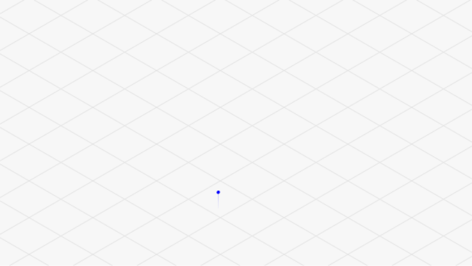
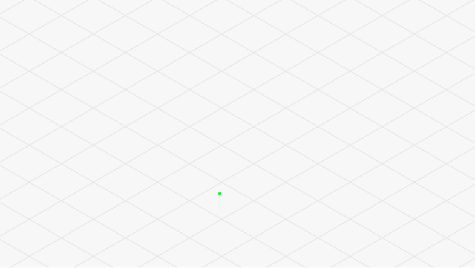
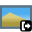

#  3D Track Viewer

  

> 💡 **项目状态说明 (Project Status)**：  
> 本插件三维轨迹渲染与时空视点同步等核心功能已**完全成熟并进入生产稳定期（Feature-Complete）**。后续不再引入激进的新功能重构，开发重心全面转向 QGIS 长期支持版（LTR）与新版本的持续兼容与缺陷维护。

[中文](#中文) | [English](#english)

---

## 中文说明

3D Track Viewer 是一款 QGIS 三维轨迹分析与查看插件。它可以读取当前工程中的点、线矢量图层或本地 GPX 文件，并以交互式三维视图展示轨迹的高程、速度和坡度变化。

### 动图演示 / Previews

| 高程着色 / Elevation | 坡度着色 / Slope | 速度着色 / Speed |
| :---: | :---: | :---: |
|  |  |  |

### 功能特点

- **多源数据支持**：查看 QGIS 工程中的点图层和线图层，或直接打开本地 GPX 轨迹文件。
- **三维多指标渲染**：按高程、速度或坡度为轨迹动态着色。
- **显示控制**：调整垂直夸张倍数、轨迹粗细、线段渐变以及设置自动、裁剪锁定或手动色阶范围。
- **视角控制**：提供三维球体拖拽、方位角/俯仰角精确控制以及视口适配。
- **轨迹动画与裁剪**：支持基于时间的轨迹区间裁剪、沿轨迹跟随属性显示以及相机关键帧动画编辑。
- **多格式导出**：支持导出高清 PNG 图片、矢量 SVG 图、PDF 文档以及 GIF 关键帧动画。
- **工程无缝集成**：可在三维窗口中直接切换工程图层，并使用  **导入至 QGIS** 按钮将临时 GPX 轨迹一键导入当前 QGIS 工程。

### 支持的数据

插件支持以下输入：

- 当前 QGIS 工程中的点矢量图层。
- 当前 QGIS 工程中的线矢量图层。
- 包含轨迹点或轨迹线的本地 `.gpx` 文件。

| 数据能力 | 相关功能 |
| --- | --- |
| 高程或 Z 值 | 三维高度、高程着色、坡度计算和高度自适应 |
| 时间 | 速度计算、时间裁剪、跟随显示和动画时间轴 |
| 速度字段 | 速度着色和悬停信息 |
| 坡度字段 | 坡度着色和悬停信息 |

### 使用方法

1. 在 QGIS 中启用 3D Track Viewer 插件。
2. 点击矢量菜单或插件工具栏中的 **Open 3D Track Viewer** 按钮。
3. 从当前工程选择兼容的点线图层，或者点击“📂 打开本地 GPX 文件...”。
4. 点击“Open 3D View”进入三维轨迹交互窗口。
5. 使用鼠标旋转、平移和缩放轨迹，或在控制面板中调整各项显示参数。

### 三维窗口操作

| 图标 | 功能按钮 / 操作 | 说明 |
| :---: | --- | --- |
|  | 左键拖动 | 旋转三维视角 |
|  | 右键拖动 | 平移视图 |
|  | 鼠标滚轮 | 缩放视图 |
|  | **高度自适应** | 自动计算合适的垂直夸张倍数 |
|  | **缩放到图层** | 将当前可见轨迹适配到视口 |
|  | **重置视角** | 恢复默认观察视角 |
|  | **轨迹时间裁剪** | 开启或关闭轨迹时间裁剪 |
|  | **关键帧动画** | 开启或关闭相机关键帧编辑 |
|  | **跟随显示** | 沿当前轨迹显示插值属性 |

### 导出功能

-  **PNG**：导出当前三维视口的高清图像。
-  **SVG**：导出可继续编辑的矢量场景。
-  **PDF**：导出三维视图文档。
-  **GIF**：按照当前裁剪区间、播放速度和有效关键帧导出动画（需要 Python 环境安装 `Pillow`）。

---

## English Description

**3D Track Viewer** is a QGIS plugin for interactive 3D track visualization and analysis. It reads point and line vector layers from the current project or local GPX files, presenting track elevation, speed, and slope variations in an interactive 3D scene.

### Feature Highlights

- **Multi-source Data**: Supports point/line layers from the active QGIS project or standalone `.gpx` files.
- **3D Metric Rendering**: Dynamic track coloring by elevation, speed, or slope.
- **Visual Customization**: Adjustable vertical exaggeration, line width, color gradient, and color ramp range modes (Auto, Clipped, Manual).
- **Navigation Controls**: Mouse orbital drag, azimuth/elevation angle fine-tuning, and viewport fitting.
- **Animation & Clipping**: Time-range track clipping, interactive follow display along the track, and camera keyframe animation.
- **Export Options**: Export high-resolution PNG, editable SVG vectors, PDF documents, and animated GIFs.
- **QGIS Integration**: Switch active project layers directly inside the 3D viewer and use the  **Import to QGIS** button to import temporary GPX tracks into the QGIS project.

### Supported Data

| Attribute / Field | Related Features |
| --- | --- |
| Elevation / Z | 3D Height, Elevation rendering, Slope calculation, Height auto-fit |
| Time | Speed calculation, Time clipping, Follow display, Animation timeline |
| Speed Field | Speed color rendering & hover metrics |
| Slope Field | Slope color rendering & hover metrics |

### Usage Guide

1. Enable **3D Track Viewer** in the QGIS Plugin Manager.
2. Click the **Open 3D Track Viewer** button in the Vector menu or toolbar.
3. Select a compatible layer from the current project or click **📂 Open Local GPX File...**.
4. Click **Open 3D View** to launch the interactive 3D window.
5. Control the scene using mouse drag/scroll and adjust parameters in the side panel.

### Viewport Controls

| Icon | Input / Control | Description |
| :---: | --- | --- |
|  | Left Drag | Rotate 3D perspective |
|  | Right Drag | Pan viewport |
|  | Mouse Wheel | Zoom in / out |
|  | **Height Auto-fit** | Automatically calculate optimal vertical exaggeration |
|  | **Zoom to Layer** | Fit visible track within viewport |
|  | **Reset View** | Restore default camera perspective |
|  | **Track Time Clipping** | Enable / disable time-based track filtering |
|  | **Keyframe Animation** | Open / close camera keyframe animation editor |
|  | **Follow Display** | Interpolate and display metrics along the track line |

### Export Options

-  **PNG**: Capture viewport raster image.
-  **SVG**: Export editable vector scene.
-  **PDF**: Export 3D view document.
-  **GIF**: Render camera keyframe animation as an animated GIF (requires `Pillow` package).

---

## Compatibility & Safety Limits

- **QGIS Version**: 3.1 - 4.99
- **Qt Compatibility**: Qt 5 / QtWebKit on QGIS 3 and Qt 6 / QtWebEngine on QGIS 4.
- **Plugin Category**: Analysis
- **GPX File Size Limit**: 100 MB max per file
- **Feature Limit**: 100,000 features max per layer
- **Segment Limit**: 100,000 line segments max per track
- **GIF Export Limit**: 450 frames max (memory safety limit ~512 MB)

---

## Author & Contact

- **Author**: OpenQGIS
- **Email**: OpenQGIS@outlook.com

---

## Changelog

### Version 1.2.0

- 🔧 **QGIS 4 / Qt 6 Compatibility**: Added Qt 6 support while retaining compatibility with QGIS 3 and Qt 5.
- 🎛️ **Panel-first Input**: The plugin now opens directly into its panel, where QGIS layers can be selected and local GPX files can be opened or dropped.
- ⏱️ **Timeline Reliability**: Fixed time clipping and added automatic start/end keyframes when playback begins with an empty keyframe list.
- ⚙️ **Native Settings**: Replaced the embedded unit settings panel with a QGIS-native popup and synchronized accepted values with the active 3D view.
- 🎨 **Interaction Polish**: Unified toolbar states, local-GPX import visibility, collapsed-sidebar behavior, and rotate/pan indicator hit testing.

### Version 1.1.0

- 🌐 **Full Multi-Language (i18n) Support**: Added 12 language bundles (`.ts`/`.qm`) with dynamic QTranslator loading and deep fallback mechanisms across all UI popups, file dialogs, and error messages.
- 🎨 **Toolbar UI Optimization**: Set button size to 28x28px, icon size to 24x24px, and integrated native `Export_to_QGIS.svg` icon.
- 📖 **Documentation Upgrade**: Added 3 GIF animation previews, SVG component icons, mouse interaction icons, and full English bilingual sections to README.
- 🐛 **Bug Fixes**: Fixed missing Qt module `QLocale` import and deep popup localization fallback logic.

### Version 1.0.1

- 🔧 Updated 3D rendering dependencies to fixed local copies; removed runtime remote script loading.
- 🐛 Fixed content-injection risks when writing layer names and track attributes into the 3D view.
- 🔧 Updated temporary track files to use unique names with automatic cleanup upon window closure.
- ⚡ Added memory safety limits for GPX files, track features, segments, and GIF export while optimizing elevation smoothing performance.

### Version 1.0.0

- ✨ Initial release with 3D track visualization for QGIS layers and local GPX files.
- ✨ Elevation, speed, and slope coloring with controls for exaggeration, width, range, and gradients.
- ✨ Track time clipping, follow display, and camera keyframe animation.
- ✨ PNG, SVG, PDF, and GIF export options.
- 🚀 Layer switching within 3D window and importing temporary GPX tracks into current QGIS project.
